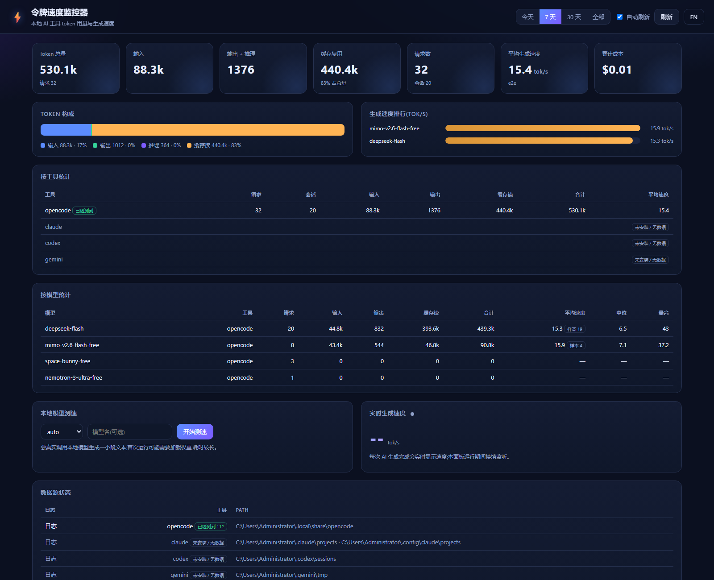

# token-speed-monitor

**Measure how many tokens your AI tools have used — and how fast they generate.**

A zero-dependency, read-only tool (also packaged as an [agent skill](#use-as-an-agent-skill))
that answers two questions about the AI software installed on your computer:

- 📊 **Token totals** — how many tokens each tool consumed (input / output / reasoning / cache), per tool, per model, per time range.
- ⚡ **Generation speed** — tokens per second (tok/s), from session history *and* as a live benchmark for local LLM servers.

Everything runs locally. No accounts, no telemetry, no network calls except
`localhost` requests to your own LLM servers when benchmarking.

## Supported sources

| Source | Data read from | Speed measurement |
| --- | --- | --- |
| **OpenCode** | `~/.local/share/opencode/opencode.db` (SQLite) + legacy JSON storage | ✅ exact (call start → completion) |
| **Claude Code** | `~/.claude/projects/**/*.jsonl` | ~ approx (turn duration pairing) |
| **Codex CLI** | `~/.codex/sessions/**/rollout-*.jsonl` | ~ approx (token-count deltas) |
| **Gemini CLI** | `~/.gemini/tmp/**/chats/session-*.json` | totals only |
| **Ollama** | `http://127.0.0.1:11434` (local server) | ✅ exact live benchmark |
| **LM Studio** | `http://127.0.0.1:1234` (local server) | ✅ exact live benchmark |
| **llama.cpp** | `http://127.0.0.1:8080` (local server) | ✅ exact live benchmark |

## Quick start

Requires **Node.js ≥ 22** (older versions work for everything except the
OpenCode database source). No `npm install` needed — it's a single script.

```bash
git clone https://github.com/<you>/token-speed-monitor
cd token-speed-monitor

node scripts/token-stats.mjs list       # what AI software was detected
node scripts/token-stats.mjs summary    # token totals
node scripts/token-stats.mjs speed      # generation speed from history
node scripts/token-stats.mjs watch      # live: tok/s of new completions
node scripts/token-stats.mjs bench      # live benchmark of local LLM servers
```

### Example output

```text
$ node scripts/token-stats.mjs summary
AI TOKEN STATS v0.2.0  ·  2026/10/17 20:17:12  ·  since: all time

TOTALS BY TOOL
  [opencode]  92 requests · 10 sessions
      5.83M tokens  =  in 369.6k + out 29.1k + reason 427 + cacheR 5.43M + cacheW 0
  [claude]  not detected
  [codex]  not detected
  [gemini]  not detected
  [ALL]  5.83M tokens · 92 requests · 10 sessions

TOP MODELS
model                  tool      reqs  input   output  cache-read  total  avg tok/s
---------------------  --------  ----  ------  ------  ----------  -----  ---------
space-bunny-free       opencode  83    326.2k  28.7k   5.38M       5.73M  47.2
mimo-v2.6-flash-free   opencode  8     43.4k   456     46.8k       90.8k  15.9
```

```text
$ node scripts/token-stats.mjs speed
GENERATION SPEED (tokens/sec)  ·  since: all time

  [opencode]  83 samples (exact)   avg 45.7 · p50 26.8 · p90 106 · max 135.8 tok/s
```

```text
$ node scripts/token-stats.mjs bench ollama --model qwen3:4b --max-tokens 64
OLLAMA BENCHMARK  http://127.0.0.1:11434  model=qwen3:4b  max_tokens=64
  model load:       8.5 s
  prompt eval:      23 tok in 0.1s  ->  173.1 tok/s
  generation:       64 tok in 0.7s  ->  91.8 tok/s
  wall clock:       9.3 s
```

```text
$ node scripts/token-stats.mjs watch
WATCHING (poll every 2s, Ctrl+C to stop)
sources  opencode:on  claude:on  codex:off  gemini:off

21:03:14  opencode  qwen3.5-coder-30b            412 out · 6.8s · 60.6 tok/s (exact)
21:04:02  claude    claude-sonnet-4-5              96 out · 6.1s · 15.7 tok/s (approx)
21:04:40  gemini    gemini-2.5-pro               340 tokens (150 in / 190 out) · no timing data
```

---

## 🖥️ Dashboard (GUI)

Prefer clicking to typing? Start the local dashboard — it opens automatically in your
browser with stat cards, charts, a live speed feed and a one-click local-model benchmark.



<sub>Cards, token composition, per-model speed ranking, per-tool / per-model tables,
local-model benchmark and the live speed feed — all in Chinese or English.</sub>

| Platform | How to start |
| --- | --- |
| Windows | Double-click **`启动面板.cmd`** |
| Any | `npm start`, or `node app/server.mjs` |
| macOS / Linux | `node app/server.mjs` (uses `open` / `xdg-open`) |

Then open <http://127.0.0.1:7391/> if the browser did not come up.

Dashboard features:

- **Stat cards** — total tokens, input, output + reasoning, cache reads, requests, sessions, average speed, cost
- **Time ranges** — today / 7 days / 30 days / all time, with optional 15-second auto refresh
- **Composition bar + tables** — per-tool and per-model totals with p50 / max speed
- **Live speed feed** — a Server-Sent Events stream; every finished generation appears instantly
- **One-click benchmark** — Ollama / LM Studio / llama.cpp: load time, prompt eval speed, tok/s
- **Bilingual UI** — 中文 / English toggle in the header

### Single-file `.exe` (nothing to install)

`scripts/build-sea.ps1` bundles Node.js, the CLI, the local server and the dashboard UI into
one Windows executable — **`dist/Token Speed Monitor.exe`** (~88 MB):

```powershell
npm install                                        # dev-only: esbuild, postject, rcedit
powershell -ExecutionPolicy Bypass -File scripts\build-sea.ps1
```

- Double-click it: it starts a hidden local server and opens the dashboard.
- **No Node.js, no installer, no internet** — it only talks to `127.0.0.1`.
- The dashboard files are embedded in the binary; nothing is written outside it.
- Closing the dashboard window shuts the app down automatically.
- It also works as a CLI: `Token Speed Monitor.exe --cli summary --json --since 24h`.

### Windows app mode & tray

| Launcher | What happens |
| --- | --- |
| `启动面板.cmd` | Starts the server in the background and opens the dashboard in a **standalone application window** (Edge/Chromium `--app` mode: no tabs, no address bar) — it looks like a real desktop app |
| `托盘常驻.cmd` | Adds a **tray icon** that stays in the notification area: hover to see live tok/s + today's tokens, double-click to open the panel, right-click for *Benchmark* / *Start with Windows* / *Desktop shortcut* / *Quit* |

The live panel is never blank: on start it replays the **last 12 finished generations**,
and a message that was still streaming updates **in place** when it completes.

Notes:

- Binds `127.0.0.1` only; nothing leaves your machine.
- Change the port with `TOKEN_STATS_PORT=8080 node app/server.mjs`.
- Skip the automatic browser launch with `TOKEN_STATS_NO_OPEN=1`.
- Add `?nolive=1` to the dashboard URL to disable the live stream (handy for screenshots or embedding).
- Closing the app window does not stop the server; use the tray menu → *Quit* (or close the console) to stop it.

---

## Commands

| Command | What it does |
| --- | --- |
| `summary` | Token totals by tool and model (default command) |
| `speed` | Generation speed statistics (avg / p50 / p90 / max tok/s) from history |
| `watch` | Polls session files and prints one line per newly completed generation |
| `bench [target]` | Live benchmark: `ollama`, `lmstudio`, `llamacpp` or `auto` |
| `list` | Shows which AI software and data sources were detected |

Options:

| Option | Meaning |
| --- | --- |
| `--since <7d\|24h\|2w\|2026-01-01>` | Only count activity since then |
| `--tool <opencode,claude,codex,gemini>` | Limit to specific tools |
| `--json` | Machine-readable output (`watch`: JSON Lines) |
| `--interval <seconds>` | `watch` poll interval (default 2) |
| `--model <name>` / `--prompt <text>` / `--max-tokens <n>` | `bench` tuning |

Advanced: `--home <dir>` and the `TOKEN_STATS_*` environment variables
(`TOKEN_STATS_OPENCODE_DIR`, `TOKEN_STATS_CLAUDE_DIR`, `TOKEN_STATS_CODEX_DIR`,
`TOKEN_STATS_GEMINI_DIR`, `TOKEN_STATS_OLLAMA_URL`, `TOKEN_STATS_LMSTUDIO_URL`,
`TOKEN_STATS_LLAMACPP_URL`) relocate sources — handy for tests or non-standard installs.

## How speed is measured

- **`exact`** — the application itself recorded the duration of the model call.
  OpenCode stores `time.created`/`time.completed` per message; local LLM servers
  report decode timing directly (`eval_count / eval_duration` for Ollama,
  `timings` for llama.cpp, `stats` for LM Studio). This is *effective* throughput:
  it includes first-token latency.
- **`approx` (marked with `~`)** — derived from log timestamps:
  Claude Code's `turn_duration` events, or deltas between Codex `token_count`
  events. These windows may also contain tool execution or user think time, so
  treat them as lower-bound estimates.
- **No timing data** — Gemini CLI sessions don't record per-call durations;
  only totals are reported.

Token totals follow each tool's own accounting: `input` excludes cache reads
where the tool reports them separately, `reasoning` is tracked for tools that
expose it, and cache read/write are listed as their own columns.

## Use as an agent skill

This repo *is* an agent skill: `SKILL.md` describes when and how an AI coding
agent should use it. Copy the folder into your agent's skills directory:

| Agent | Skills directory (user-level) |
| --- | --- |
| Claude Code | `~/.claude/skills/token-speed-monitor/` |
| OpenCode | `~/.config/opencode/skills/token-speed-monitor/` (or `.opencode/skills/` in a project) |
| Other agents | wherever your agent loads skills from |

Then just ask, e.g. *"how many tokens did I use this week?"*, *"how fast is
qwen3 generating locally?"* — the agent loads the skill and runs the commands.

## Privacy

- Read-only: the script never writes to session files or databases.
- No telemetry, no external network calls. The only HTTP requests go to
  `127.0.0.1` LLM servers, and only for `bench` / `list`.
- All parsing happens locally.

## Development

```bash
node test/run-tests.mjs   # builds synthetic fixtures for all sources and asserts numbers
```

The test suite covers OpenCode (SQLite + legacy JSON), Claude Code, Codex CLI
and Gemini CLI parsing without needing those tools installed.

## Related projects

- [ccusage](https://github.com/ccusage/ccusage) — excellent CLI for token/cost reports across many agents
- [tokscale](https://github.com/junhoyeo/tokscale) — cross-agent token tracking with leaderboards
- [token-monitor](https://github.com/Javis603/token-monitor) — desktop widget for usage & limits
- [Claude-Code-Usage-Monitor](https://github.com/Maciek-roboblog/Claude-Code-Usage-Monitor) — real-time Claude Code monitor

`token-speed-monitor` is intentionally small: zero dependencies, focused on
**speed metrics**, and packaged as a skill so AI agents can use it themselves.

## License

[MIT](LICENSE)
